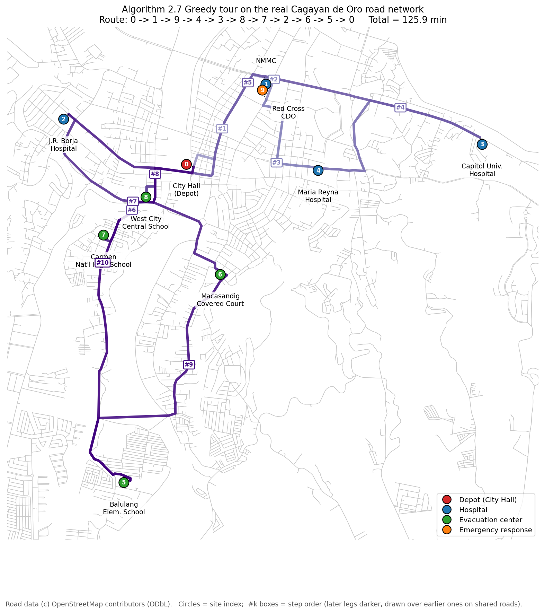
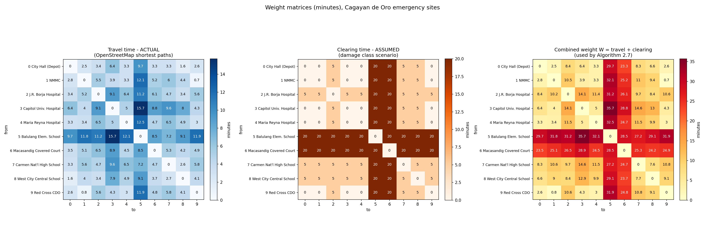
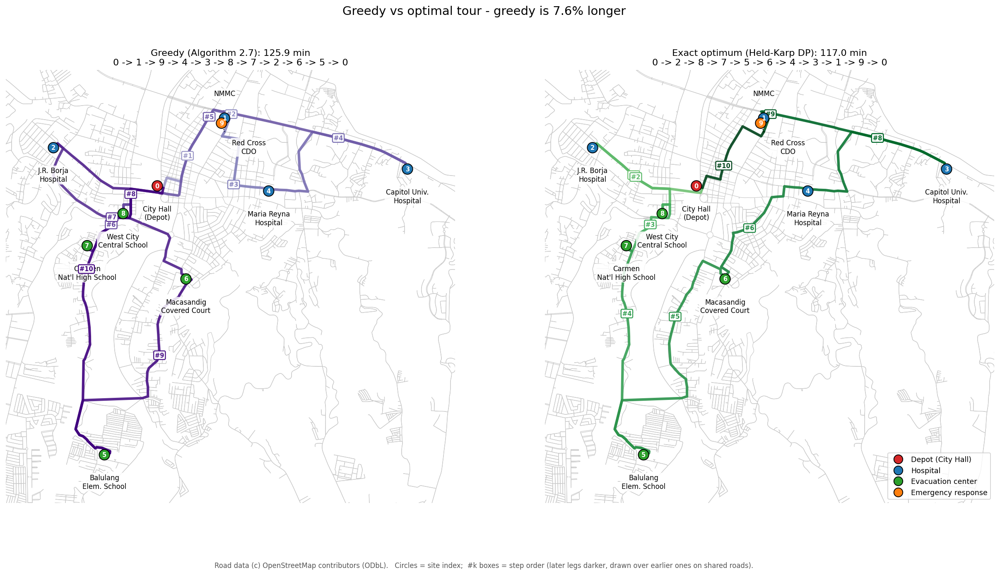

# Greedy TSP for Post-Disaster Response — Cagayan de Oro City

A real-life **Traveling Salesperson Problem (TSP)** solved with **Algorithm 2.7, the Greedy (Nearest-Neighbor) approach**, from Luna-Garcia, Candano & Caga-anan (2024). The travel times come from the real **OpenStreetMap** road network.

**Group members:** Gerlie Campion, Francis Esteban, Jhey Gulde, Kathleen Gultiano, John Carl Ramirez. University of Science and Technology of Southern Philippines.

The full write-up is in [`report/report.pdf`](report/report.pdf).



## Problem

A typhoon has flooded and blocked roads across Cagayan de Oro. An emergency response crew starts at a central depot. It must reach every critical site exactly once to deliver supplies and assess damage, then return to the depot.

**Objective:** minimize the total round-trip time in minutes, where each leg's time is the travel time plus the road-clearing time.

| # | Site | Category |
|---|------|----------|
| 0 | Cagayan de Oro City Hall | Depot |
| 1 | Northern Mindanao Medical Center | Hospital |
| 2 | J. R. Borja Memorial City Hospital | Hospital |
| 3 | Capitol University Hospital | Hospital |
| 4 | Maria Reyna–Xavier University Hospital | Hospital |
| 5 | Balulang Elementary School | Evacuation center |
| 6 | Macasandig Multipurpose Covered Court | Evacuation center |
| 7 | Carmen National High School | Evacuation center |
| 8 | West City Central School | Evacuation center |
| 9 | Philippine Red Cross – CDO Chapter | Emergency response |

## Algorithm 2.7 — Greedy approach

1. Begin at the depot.
2. While there are unvisited sites, go to the nearest unvisited site and mark it as visited.
3. Return to the depot to complete the tour.

The time complexity is **O(n²)**. The algorithm is fast and simple, but it gives an **approximate** solution and does not guarantee the shortest tour.

## Graph model and data

The graph is a complete **directed** graph with 10 vertices and 90 edges. It is directed because one-way streets make 20 of the 45 site pairs differ slightly by direction, by at most 0.6 min. Each edge weight is:

```
w(i, j) = travel_time(i, j) + clearing_time(i, j)     (minutes)
```

| Data | Source | Type |
|------|--------|------|
| Site coordinates | OpenStreetMap (Nominatim, Overpass API) | Actual |
| Road network (5,835 intersections) | OpenStreetMap via OSMnx | Actual |
| Travel time between sites | Dijkstra fastest path on the road network | Actual roads, assumed speeds |
| Driving speeds (20–40 km/h by road class) | Typical urban traffic | Assumed |
| Clearing time: `max(damage[i], damage[j])` at 0 / 5 / 20 min | Disaster scenario (Sendong-like river flooding) | Assumed |



## Results

| | Route | Total |
|---|---|---|
| **Greedy (Algorithm 2.7)** | 0 → 1 → 9 → 4 → 3 → 8 → 7 → 2 → 6 → 5 → 0 | **125.9 min** |
| Exact optimum (Held–Karp DP, Algorithm 2.2) | 0 → 2 → 8 → 7 → 5 → 6 → 4 → 3 → 1 → 9 → 0 | 117.0 min |

- The greedy tour visits every site exactly once and returns to the depot. Its total, recomputed from the edge weights, matches: 125.9 min.
- Greedy is **7.6% longer** than the optimum. The optimum is confirmed by brute force over all 9! = 362,880 tours.
- Greedy's total ranges from 121.3 to 130.1 min depending on the starting site.
- The last three legs take 84.3 of the 125.9 min. The greedy rule left the flooded riverside sites (Balulang and Macasandig) for the end.



## How to run

Requires Python 3.10 or newer.

```bash
pip install osmnx networkx matplotlib
```

```bash
python build_osm_dataset.py         # road network -> data/*.csv
python tsp_greedy_cdo.py            # Algorithm 2.7 + verification + optimum check
python tsp_graph_visualization.py   # figures/*.png
```

`build_osm_dataset.py` reuses the saved road network in `data/cdo_drive.graphml`. Delete that file to download a fresh copy from OpenStreetMap.

## Files

| Path | Contents |
|------|----------|
| `tsp_greedy_cdo.py` | Site list, weight matrix, Algorithm 2.7, verification, Held–Karp optimum check |
| `build_osm_dataset.py` | Downloads the OSM road network and builds the travel-time and distance matrices |
| `tsp_graph_visualization.py` | Draws the graph, weight matrices and route maps |
| `data/nodes.csv` | Site coordinates, assumed damage class, snapped road node |
| `data/travel_time_osm_min.csv` | 10 × 10 driving-time matrix (minutes) |
| `data/distance_osm_km.csv` | 10 × 10 road-distance matrix (km) |
| `data/cdo_drive.graphml` | Saved Cagayan de Oro drivable road network |
| `figures/` | Graph model, greedy tour, weight matrices, route maps |
| `report/` | LaTeX source and compiled PDF of the full project report |

## Limitations

- Driving speeds and clearing times are assumptions, not measurements.
- The road network is static; a real flood closes roads.
- The model has no site priorities or time windows.
- Using schools as evacuation centers is an assumption; OpenStreetMap does not tag them as such.

## References

1. Luna-Garcia, R., Candano, T. M. C., & Caga-anan, R. L. (2024). Performance analysis of classical algorithms for the traveling salesman problem. *The Mindanawan Journal of Mathematics, 6*(2), 79–111. https://doi.org/10.62071/tmjm.v6i2.716
2. OpenStreetMap contributors. (2026). OpenStreetMap data for Cagayan de Oro City. Open Database License (ODbL). https://www.openstreetmap.org
3. Boeing, G. (2017). OSMnx: New methods for acquiring, constructing, analyzing, and visualizing complex street networks. *Computers, Environment and Urban Systems, 65*, 126–139.
4. Hagberg, A. A., Schult, D. A., & Swart, P. J. (2008). Exploring network structure, dynamics, and function using NetworkX. *Proceedings of the 7th Python in Science Conference*, 11–15.
5. Held, M., & Karp, R. M. (1962). A dynamic programming approach to sequencing problems. *Journal of the Society for Industrial and Applied Mathematics, 10*(1), 196–210.

Map data © OpenStreetMap contributors, available under the [Open Database License](https://www.openstreetmap.org/copyright).
